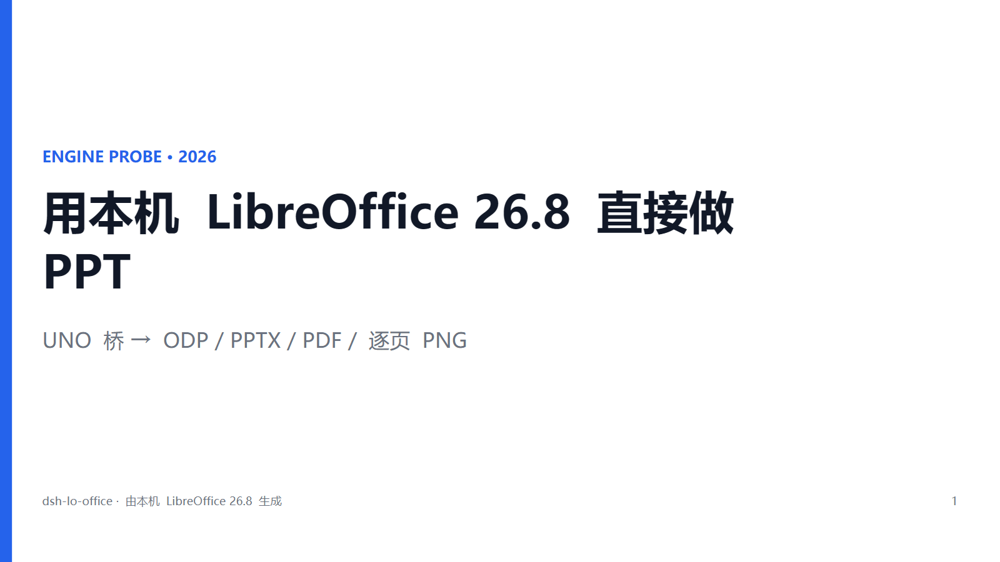
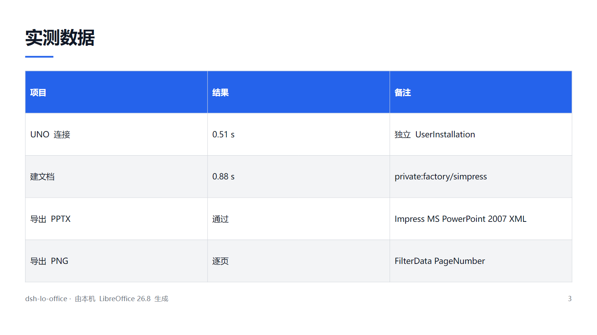
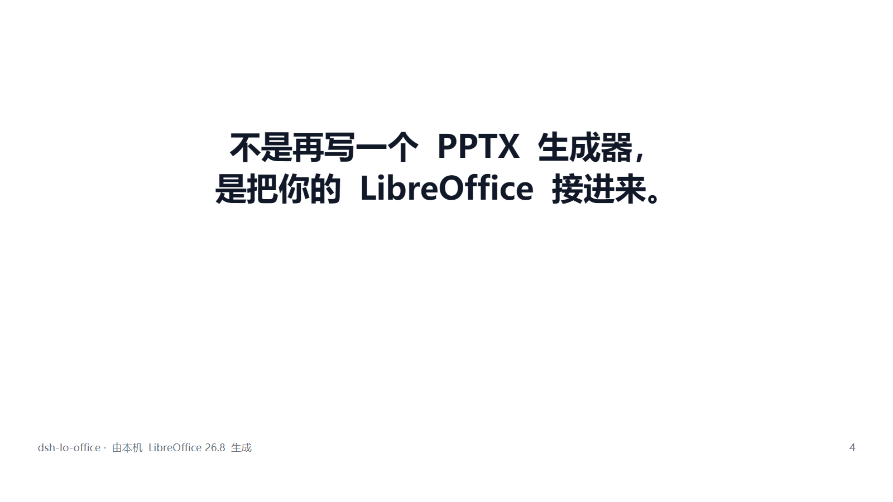
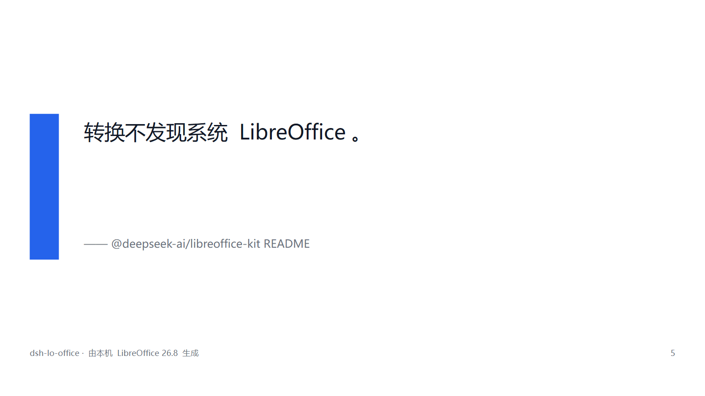

# office-ppt

> 让 DSH 直接驱动**本机安装的 LibreOffice** 做 PPT —— 通过 UNO 真开一份 Impress 文档、真往上画形状，再让 LibreOffice 自己导出 PPTX / ODP / PDF / 逐页 PNG。

不是纯 JS 的 PPTX 写入器：字体、表格、母版、备注页、导出过滤器全走 Impress 那条路，产物和你在桌面上「另存为」得到的是同一种东西。

> npm 包名是 `dsh-lo-office`（插件 id 也叫这个），仓库名是 **office-ppt**。装的时候两个名字都要用对。

```
lo_build ──▶ python/lo_bridge.py ──▶ UNO socket ──▶ Impress 文档 ──▶ storeToURL
                                                                      ├─ pptx
                                                                      ├─ odp
                                                                      ├─ pdf
                                                                      └─ png × N
```

**English** — A DeepSeek Harness plugin that builds presentations by driving the *installed* LibreOffice over UNO: it opens a real Impress document, draws real shapes, and lets LibreOffice export PPTX / ODP / PDF / per-slide PNG. Not a pure-JS OOXML writer — so fonts, tables, master pages, notes and the export filters are all LibreOffice's own. Four tools: `lo_probe`, `lo_build`, `lo_render`, `lo_convert`. Requires LibreOffice (verified on 26.8.1.1); the bundled Python is used, so no system Python is needed. Ships a settings panel (paths, theme, ratio, formats, timeouts) and keeps one warm soffice process between calls. Package name `dsh-lo-office`, repository `office-ppt`. [Changelog](CHANGELOG.md) · [MIT](LICENSE)



## 和 dsh-ppt 的区别

| | dsh-ppt | dsh-lo-office |
|---|---|---|
| PPTX 由谁生成 | 纯 JS（`@office-kit/pptx`） | 本机 LibreOffice / Impress |
| 需要装 Office 吗 | 不需要 | 需要 LibreOffice |
| 渲染预览 | 依赖外部渲染引擎 | 同一套 LibreOffice 直接出 PDF/PNG |
| 强项 | 零依赖、跨平台、快 | 真 Impress 文档、格式保真、顺手转任意文档 |

两个可以并存：要开箱即用选 dsh-ppt，要「交付的就是 LibreOffice 能打开的那个文件」选这个。

## 要求

- 本机装有 LibreOffice（Community 版即可）。已在 **26.8.1.1** 上验证；`lo_probe` 会告诉你实测结果。
- 插件自己找 `soffice`：Windows 先查注册表 `HKLM\SOFTWARE\LibreOffice\UNO\InstallPath`（含 WOW6432Node），再查常见安装路径，最后看环境变量 `DSH_LO_SOFFICE` / `LO_SOFFICE`。
- Python 用 LibreOffice 自带的那份（`<安装目录>/program/python.exe`，带 `uno` 模块），不需要系统 Python。Linux 上会退回 `python3`，需要 `python3-uno`。

## 安装

### 方式一：插件管理器（推荐）

DSH 的插件管理器接受 pnpm 的 git 规格，直接从仓库装：

```
github:OWNER/office-ppt
```

在 **设置 → 插件** 里粘贴这段（把 `OWNER` 换成仓库所属账号），或在会话里让助手调用 `plugin_manager` 的 `install_bundle`。装完重启桌面端，日志里出现 `[dsh-lo-office] 已注册 4 个工具` 即可。

### 方式二：本地开发（改代码用）

```
# 1) 把仓库链进 profile 的 node_modules
cmd /c mklink /J D:\dsh1\.dsh\profiles\desktop\node_modules\dsh-lo-office D:\dsh1\dsh-lo-office
```

```jsonc
// 2) profile 的 package.json
{
  "dependencies": { "dsh-lo-office": "link:D:/dsh1/dsh-lo-office" },
  "dsh": { "profile": { "bundles": [ /* … */, "dsh-lo-office" ] } }
}
```

bundle 条目由本仓库自带的 `cordis.patch.yml` 注入，**不需要手改 `cordis.yml`**：

```yaml
- insert:
    - id: dsh-lo-office
      name: dsh-lo-office
      config: {}
```

> ⚠️ 一定要用编辑器或 `[System.IO.File]::WriteAllText` + `UTF8Encoding($false)` 改配置。PowerShell 5.1 的 `Set-Content -Encoding UTF8` 会写 BOM，YAML 解析会挂。
>
> ⚠️ 插件源码改动**不会热重载**（DSH 的 HMR 默认只监听 profile manifest 和 patch，不监听插件源码）。改完要重启桌面端。

## 设置面板

插件声明了 `Config`（`lib/config.js`），DSH 会把它自动渲染成 **设置 → 插件 → office-ppt** 里的一张表单。只有标了 `.volatile()` 的字段会上表单，改完写进当前 profile 的 patch，不用重启就生效。

| 字段 | 默认值 | 作用 |
|---|---|---|
| `soffice` | 空（自动探测） | `soffice.exe` 完整路径；自动探测失败时填 |
| `python` | 空（用自带的） | 带 `uno` 模块的 python 解释器 |
| `theme` | `light` | 默认主题：`light` / `dark` / `slate` / `warm` / `swiss` |
| `ratio` | `16:9` | 默认画布比例（`4:3` 可选） |
| `formats` | `pptx,pdf,png` | 默认导出格式（可加 `odp`） |
| `pngWidth` | `1600` | 逐页 PNG 宽度（320–3840） |
| `footer` | `office-ppt · 由本机 LibreOffice 生成` | 默认页脚；填空字符串则不画 |
| `pageNumbers` | `true` | 默认是否显示页码 |
| `timeoutMs` | `240000` | 单次调用超时（5 秒–15 分钟） |
| `keepWarm` | `true` | 复用常驻 soffice 进程 |
| `idleMs` | `60000` | 常驻进程空闲多久回收 |

任何字段都能被单次工具调用的同名参数覆盖（例如临时换个主题），面板里的值只是默认值。

`soffice` / `python` 两项是为了替代以前的环境变量 `DSH_LO_SOFFICE` / `DSH_LO_PYTHON` —— 环境变量仍然有效，但正常情况下面板更好用。

## 常驻进程

`keepWarm` 打开时，Node 侧会保持一个 python 桥进程 + 一个无头 soffice（`lib/worker.js`）：

- 请求串行排队，一次 `spawn` 之后连续用；
- 空闲超过 `idleMs` 自动回收；
- 进程崩了下次调用自动重起；
- 插件卸载时（`dispose`）一起收掉，不留孤儿进程。

关掉它就是每次调用重开一遍 —— 排查「是不是状态没清干净」时有用。

## 取消

`lo_build` / `lo_render` / `lo_convert` / `lo_probe` 都接了 DSH 的 abort signal：会话里打断，Node 侧会杀掉整棵子进程树（`taskkill /T /F`），不会留下跑到一半的 soffice。

## 四个工具

### `lo_probe`

先跑这个。返回 soffice 路径、版本、自带 Python 版本、`uno` 能否导入，并**真的开一份无头 Impress 文档**（只探测不实开是骗人的）。参数：`soffice`（可选，自动探测失败时指定路径）。

### `lo_build`

给标题 + 结构化 slides，拿可编辑 PPTX（可选 ODP / PDF / 逐页 PNG）。

| 参数 | 说明 |
|---|---|
| `title` | 必填。封面与默认文件名 |
| `slides` | 必填。幻灯片数组，见下 |
| `theme` | `light`（默认）/ `dark` / `slate` / `warm` / `swiss` |
| `ratio` | `16:9`（默认）/ `4:3` |
| `footer` | 页脚文字，默认取设置里的页脚（出厂值 `office-ppt · 由本机 LibreOffice 生成`） |
| `pageNumbers` | 是否显示页码，默认 `true` |
| `outputDir` | 输出目录，缺省用会话工作目录 |
| `fileName` | 文件名主干，缺省取标题 |
| `formats` | 默认 `["pptx","pdf","png"]`，可用 `odp` |
| `pngWidth` | 逐页 PNG 宽度，默认 1600 |
| `overwrite` | 覆盖同名旧文件，默认 `true` |

每页字段：`layout`、`title`、`subtitle`、`kicker`（标题上方小字）、`text`、`bullets`、`rows`（首行为表头的二维数组）、`image`（绝对路径）、`notes`（讲者备注）。

版式：`cover` / `section` / `bullets` / `statement` / `quote` / `table` / `image` / `image-left` / `image-right` / `closing`。缺省 `bullets`。

```json
{
  "title": "季度回顾",
  "theme": "swiss",
  "slides": [
    { "layout": "cover", "kicker": "Q3 REVIEW", "title": "季度回顾", "subtitle": "增长、成本与下一步" },
    { "layout": "bullets", "title": "三件事", "bullets": ["留存提升", "成本下降", "新渠道跑通"] },
    { "layout": "table", "title": "指标", "rows": [["指标", "本季"], ["留存", "72%"], ["成本", "-18%"]] },
    { "layout": "quote", "text": "把复杂留给自己。", "subtitle": "设计原则" }
  ]
}
```

### `lo_render`

把已有的 PPTX / PPT / ODP 渲染成 PDF 和/或逐页 PNG —— 用来肉眼验收刚生成的东西。参数：`source`（必填）、`formats`、`outputDir`、`pngWidth`。

### `lo_convert`

任意格式互转（docx / xlsx / pptx / odt / ods / odp / pdf …），走 `soffice --convert-to`。参数：`source`、`to`（必填）、`outputDir`。

## 样张

同一份 7 页规格（`test/sample-build.json`）的产物，2.4 秒生成：

| | | |
|---|---|---|
|  |  |  |
|  |  |  |

## 命令行

不经过 DSH 也能用：

```bash
node bin/lo-ppt.mjs probe
node bin/lo-ppt.mjs build test/sample-build.json --formats pptx,pdf,png
node bin/lo-ppt.mjs render test/out/sample.pptx
node bin/lo-ppt.mjs convert 报告.docx --to pdf
```

装成本地依赖后可以直接 `lo-ppt probe`（`bin` 字段已声明）。

## 测试

```bash
npm test            # 工具 schema 必须是合法 JSON Schema（不需要 LibreOffice）
npm run test:config # 设置 schema / 归一化兜底 / volatile 容器（不需要 LibreOffice）
npm run test:json   # 返回值必须过 DSH 的 lossless-JSON 校验
npm run test:smoke  # 26 项：真跑四个工具、产物落盘校验
```

`check-json.mjs` 优先 import 桌面端自带的 `@deepseek-ai/dsh-util-values` 校验器（`DSH_APP_DIR` 可覆盖路径）；没有桌面端的机器（CI）自动退回同规则的本地镜像。

CI 见 [.github/workflows/ci.yml](.github/workflows/ci.yml)：三平台跑 schema 检查，Ubuntu 装真 LibreOffice 跑端到端。

## 性能

7 页 deck（pptx + pdf + 7 张 png）在正常机器上约 **2.4–2.6 秒**：连接 UNO 0.5s、排版 1.4s、导出累计 2.4s。首次跑要多花 ~10 秒建独立的 LibreOffice 配置目录，之后走缓存。

开了 `keepWarm` 之后第二次调用起省掉整段 soffice 启动开销 —— 实测同一进程内第二次 build 只要 **0.26 秒**。

> 本机实测到过一次异常：某个时刻起 LibreOffice 无论用什么参数、什么 profile，冷启动都卡 **32 秒**才建 socket（`soffice.bin` 的 CPU 时间从 t=2s 到 t=22s 一直冻结在 0.39s，说明在等而不是在算；默认用户 profile 也一样）。和本插件无关，是环境侧的问题。常驻进程对这种环境收益最大：第一次 33 秒，之后每次 0.26 秒。

## 实现里的几个坑（改代码前先看）

- **逐页 PNG 必须切页**。无头模式下 `FilterData.PageNumber` 会被忽略，直接循环导出会得到 N 张一模一样的图。必须 `controller.setCurrentPage(pages.getByIndex(i))` 再 `storeToURL`。
- **`private:factory/simpress` 的默认页是 28000×15750**，不是 16:9。建完页要逐页把 `page.Width/Height` 改成目标几何尺寸，否则按 33867×19050 算出来的页脚会掉到页外被裁掉。
- **Windows 路径要转 URL**。`storeToURL` 传原生路径会报 `com.sun.star.io.IOException: SfxBaseModel::impl_store … 0x81a(Error Area:Io Class:Parameter Code:26)`，必须 `uno.systemPathToFileUrl()`。
- **`soffice.exe` 是 GUI 子系统程序**，不接管道：`subprocess.run([soffice,'--version'], capture_output=True)` 会挂死。用同目录的 `soffice.com`，并给 `stdin=DEVNULL`。
- **不要用用户的默认配置目录**。插件起的是独立 `-env:UserInstallation`，否则会抢用户正在开的 Impress，或者被用户开的实例挡住。
- **工具返回值必须是纯 JSON**。任何不可枚举的自有属性都会被 DSH 判为 `value is not lossless JSON`（见 `lib/tools.js` 里的 `renderCwd` WeakMap）。
- **工具的 `parameters` 是原生 JSON Schema**，`required` 必须写成字符串数组；写成 `required: true` 会让整个请求报 `Invalid schema for function`。
- **`soffice.exe` 的退出码不等于成功**。`--convert-to` 失败时它照样返回 0，必须检查产物文件在不在、字节数是否非零。
- **常驻进程要连带杀掉整个进程树**。`soffice.exe` 会再建一个 `soffice.bin`，只 kill 父进程会留下孤儿，下次启动被它挡住。Windows 上用 `taskkill /T /F /PID`。

## 已知边界

- 切页动画：`TransitionType` / `Duration` 设置后导出 XML 里确实有 `<p:transition>`，但 LibreOffice 自己回读是 0 —— 导出保住，内部回读不保。
- 图表：用 OLE2Shape 做容器导出成 `graphicFrame`，但**空图表**回读会少一个形状。要图表就喂真数据。
- SWF 导出：26.8 没有这个过滤器，别试。
- 备注页在 26.8 里没有 `com.sun.star.presentation.NotesShape` 服务名，是按「备注页上的 Text 形状」写的。
- 只在 Windows + LibreOffice 26.8.1.1 上做过完整验证；macOS / Linux 的路径探测和 CI 已就位，但未人工目视验收。
- 还没有 `chart` 版式（图表要用 OLE2Shape 喂真数据，见上），也没有「拿现成 pptx 当模板继承」的能力。

## 排错

1. 先跑 `lo_probe`。它失败会直接告诉你缺哪一环。
2. LibreOffice 装在非常规位置 → 设 `DSH_LO_SOFFICE` 指向 `soffice.exe`，或给 `lo_probe` 传 `soffice` 参数。
3. 生成慢或超时 → 检查是不是有别的 soffice 实例占着 socket；插件已经随机端口 + 独立 profile，正常不会撞。
4. 桌面端日志：`%APPDATA%\DSH Desktop\logs\host\dsh-<日期>.log`，搜 `dsh-lo-office`。

## 许可

[MIT](LICENSE)
